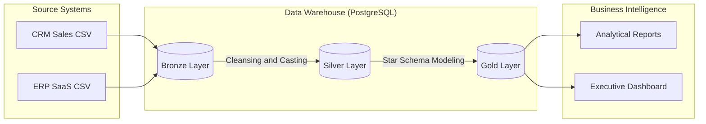
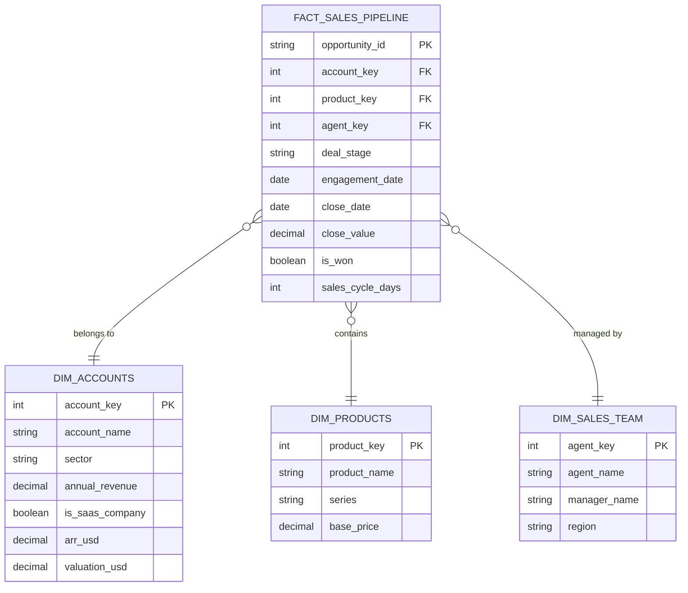

# Modern SQL Data Warehouse — Portfolio Case Study

[](https://www.postgresql.org/)
[](#technical-reference)
[](#technical-reference)

> Consolidating CRM and ERP data into a PostgreSQL analytical warehouse using Bronze → Silver → Gold medallion layers and a star schema.

---

## Why I built this

Executive teams cannot make consistent decisions when CRM sales data and ERP financial data live in separate silos with different grains. I built this warehouse to practice **trustworthy analytics engineering** — not just writing SQL, but designing layers that survive messy real-world CSVs.

## The challenge

- **Data quality:** Raw exports had inconsistent types, human-readable currency strings, and duplicate grains between CRM opportunities and ERP accounts.
- **Architecture:** Learning medallion layers in theory is easy; enforcing Bronze → Silver → Gold discipline in practice was harder than expected.
- **Modeling:** I had to decide what belonged in dimensions vs facts before writing analytical queries.

## What I did

1. Designed **Bronze, Silver, and Gold** schemas in PostgreSQL with explicit DDL and load procedures.
2. Built cleansing and casting logic in the Silver layer (including human-readable parsing functions).
3. Modeled a **star schema** in Gold: `fact_sales_pipeline` + `dim_accounts`, `dim_products`, `dim_sales_team`.
4. Wrote executive SQL — regional revenue, SaaS ARR leaderboard — against the gold layer only.

## What I learned

- Medallion architecture is about **trust at each hop**, not buzzwords on a diagram.
- Star schema design forces you to ask the business question *before* aggregating.
- Stored procedures for `load_bronze` → `load_silver` → `load_gold` make the pipeline repeatable for reviewers.

## How this leveled me up

| | |
|---|---|
| **Before** | I wrote one-off SQL against raw CSVs in notebooks |
| **After** | I can design layered warehouses, dimensional models, and repeatable load pipelines |
| **Unlocked next** | Analytics engineering vocabulary → Dynamic Pricing data thinking and BI deliverables |

## Demo / proof

- Datasets included in `/datasets`
- Sample analytical queries below in [SQL Showcase](#sql-showcase-business-insights)
- Setup: PostgreSQL + scripts in `/scripts` (see [Getting Started](#getting-started))

---

## Technical reference

### The business problem

Managing disparate data from multiple sources (CRM and ERP) often leads to data silos where executive decision-making is slowed by inconsistent metrics. This project consolidates raw SaaS sales and financial data into a single analytical data warehouse.

### Architecture: The Medallion Flow



### Data modeling: Gold layer (star schema)



### SQL showcase: Business insights

#### 1. Sales performance by region

```sql
SELECT 
    t.region,
    COUNT(f.opportunity_id) AS total_deals,
    SUM(f.close_value) AS total_revenue
FROM gold.fact_sales_pipeline f
JOIN gold.dim_sales_team t ON f.sales_agent_key = t.sales_agent_key
WHERE f.is_won = TRUE
GROUP BY t.region
ORDER BY total_revenue DESC;
```

#### 2. SaaS leaderboard (ARR vs valuation)

```sql
SELECT 
    account_name,
    arr_usd / 1000000000.0 AS arr_billions,
    valuation_usd / 1000000000.0 AS valuation_billions,
    sector
FROM gold.dim_accounts
WHERE is_saas_company = TRUE
ORDER BY arr_usd DESC
LIMIT 5;
```

### Getting started

**Prerequisites:** PostgreSQL (or pgAdmin 4); datasets in `/datasets`.

1. Execute `scripts/Init_database.sql` to create schemas.
2. Run DDL scripts in order:
   - `scripts/bronze_layer/ddl_bronze_layer.sql`
   - `scripts/silver_layer/ddl_silver_layer.sql`
   - `scripts/gold_layer/ddl_gold_layer.sql`
3. Load data:
   ```sql
   CALL bronze.load_bronze();
   CALL silver.load_silver();
   CALL gold.load_gold();
   ```
