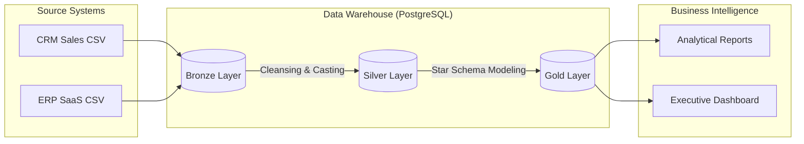
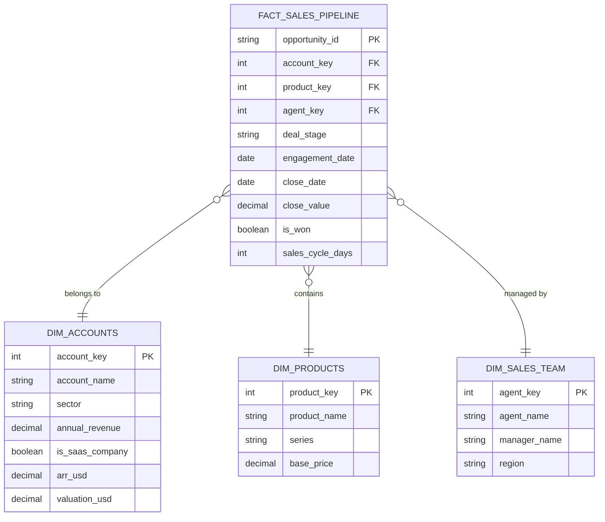

# 🏛️ Modern SQL Data Warehouse: Medallion Architecture

[](https://www.postgresql.org/)
[](#architecture)
[](#data-modeling)

## 🚀 The Business Problem
Managing disparate data from multiple sources (CRM and ERP) often leads to "data silos" where executive decision-making is slowed by inconsistent metrics. This project solves that by consolidating raw SaaS sales and financial data into a single, high-performance **Analytical Data Warehouse**.

---

## 🏗️ Architecture: The Medallion Flow
We use the **Medallion Architecture** to ensure data quality and reliability throughout the pipeline.



---

## 💎 Data Modeling: Gold Layer (Star Schema)
The final stage of the pipeline transforms cleaned data into a high-performance **Star Schema** optimized for analytical queries.



---

## 📈 SQL Showcase: Business Insights

### 1. Sales Performance by Region
*Identifies which regions are driving the highest revenue to optimize sales team allocation.*
```sql
SELECT 
    t.region,
    COUNT(f.opportunity_id) AS total_deals,
    SUM(f.close_value) AS total_revenue
FROM gold.fact_sales_pipeline f
JOIN gold.dim_sales_team t ON f.sales_agent_key = t.sales_agent_key
WHERE f.is_won = TRUE
GROUP BY t.region
ORDER BY total_revenue DESC;
```

### 2. SaaS Leaderboard (ARR vs. Valuation)
*Enriches CRM account data with ERP financial metrics to identify high-value enterprise clients.*
```sql
SELECT 
    account_name,
    arr_usd / 1000000000.0 AS arr_billions,
    valuation_usd / 1000000000.0 AS valuation_billions,
    sector
FROM gold.dim_accounts
WHERE is_saas_company = TRUE
ORDER BY arr_usd DESC
LIMIT 5;
```

---

## 🛠️ Getting Started

### Prerequisites
- PostgreSQL (or PGAdmin 4)
- Original Datasets (included in `/datasets`)

### Setup Instructions
1. **Initialize Database**: Execute `scripts/Init_database.sql` to create the schemas.
2. **Define Tables**: Run the DDL scripts in order:
   - `scripts/bronze_layer/ddl_bronze_layer.sql`
   - `scripts/silver_layer/ddl_silver_layer.sql`
   - `scripts/gold_layer/ddl_gold_layer.sql`
3. **Execute Load**: Run the stored procedures to ingest and transform data:
   ```sql
   CALL bronze.load_bronze();
   CALL silver.load_silver();
   CALL gold.load_gold();
   ```
